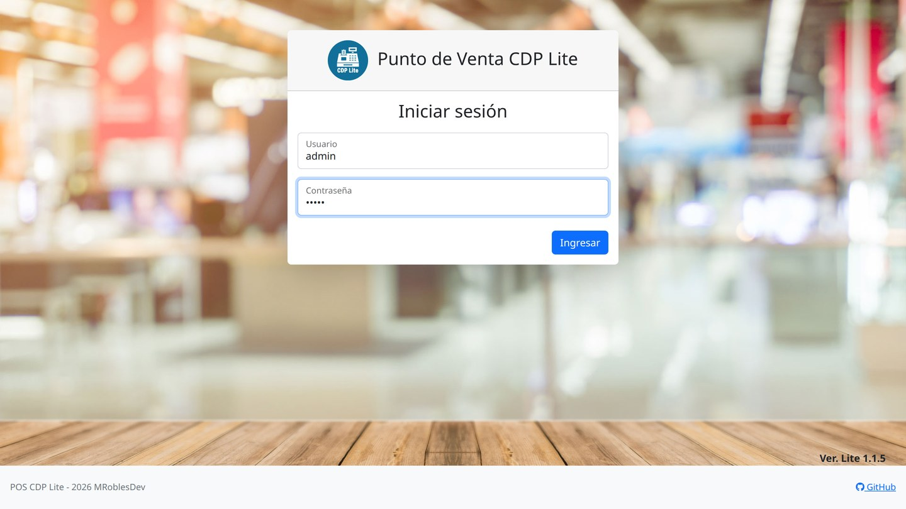
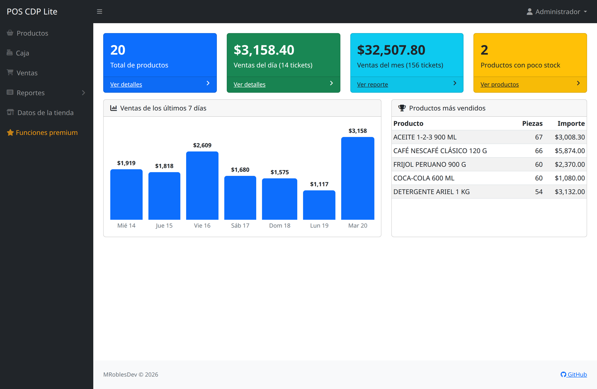
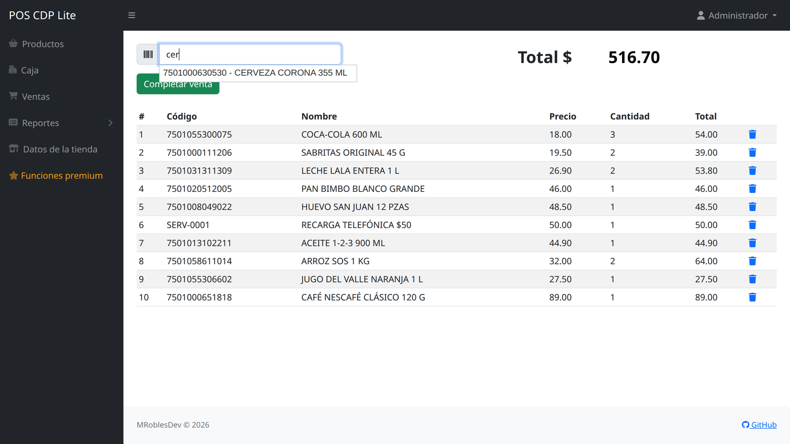
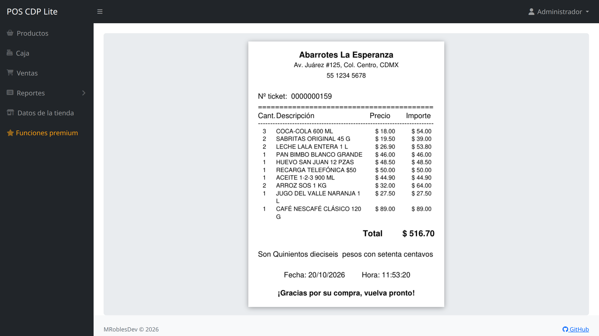
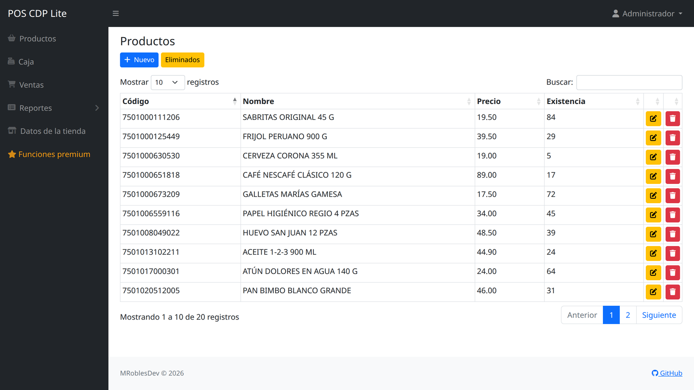
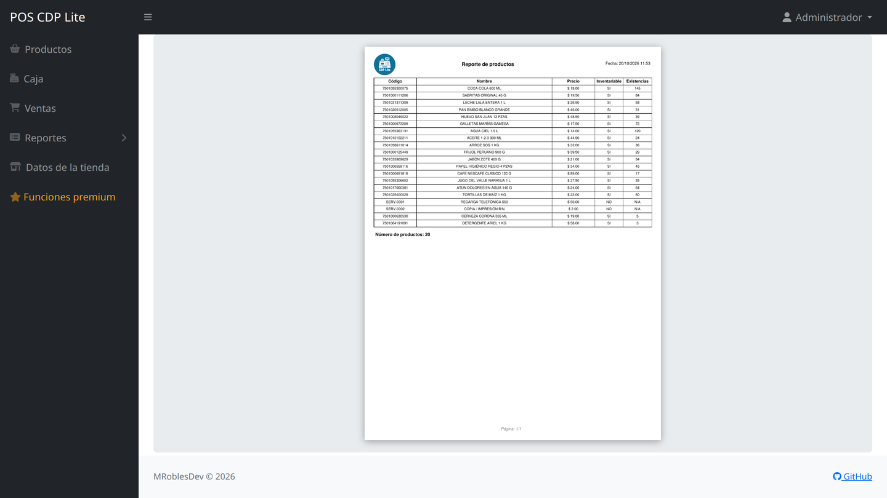

# Sistema de Punto de Venta CDP Lite


El sistema de punto de venta CDP Lite es una aplicación web de código abierto basada en PHP y MySQL para gestionar las ventas en tu tienda. Este proyecto fue desarrollado utilizando CodeIgniter 4.

🔎 **Pruébalo en línea:** https://pos-lite.sistemarv.com

## Capturas de pantalla

| | |
| --- | --- |
| <br>**Inicio de sesión** | <br>**Dashboard** |
| <br>**Caja de cobro** | <br>**Ticket de venta** |
| <br>**Catálogo de productos** | <br>**Reportes** |

## Características versión 1.1.5

- Acceso por credenciales
- Dashboard
  - Ventas del día y del mes
  - Gráfica de ventas de los últimos 7 días
  - Productos más vendidos
  - Aviso de productos con poco stock
- Catálogo de productos
  - Productos con o sin control de inventario
  - Búsqueda por código de barras o nombre con autocompletado
- Caja de cobro
  - Control de existencias: se descuentan al vender y se restituyen al cancelar
- Generación de ticket
- Historial de ventas
  - Reimpresión de ticket
  - Cancelar ventas
- Reportes
  - Ventas
  - Productos
- Configuración del sistema
  - Datos de la tienda, leyenda del ticket y folio de ventas
  - Cambio de contraseña

### 🚀 ¿Buscas más funcionalidades?

Si necesitas más características y herramientas para crecer tu negocio, te invitamos a conocer POS CDP Pro, la versión completa que incluye:

- Múltiples cajas de venta y usuarios.
- Gestión de movimientos de inventario.
- Caja de cobro avanzada.
- Módulos de clientes, categorías y unidades de medida.

[¡Obtén más información aquí!](https://codigosdeprogramacion.com/2021/09/02/sistema-de-punto-de-venta-cdp-3)

## Requisitos

- Servidor web (Apache Server 2.4 o superior).
- PHP 8.1 o superior.
  - Extensión [intl](http://php.net/manual/en/intl.requirements.php)
  - Extensión [mbstring](http://php.net/manual/en/mbstring.installation.php)
- MySQL 5.6 o superior.
- Composer (opcional)
- Git (opcional)

## Instalación
### 1. Descarga:

#### Composer

```sh-session
$ composer create-project mroblesdev/pos-cdp-lite
```

> También puedes ejecutar composer create-project mroblesdev/pos-cdp-lite:v1.1.3 para PHP 7.4.

#### Git

```sh-session
$ git clone https://github.com/mroblesdev/pos-cdp-lite.git
```

### Descarga manual

Alternativamente, si no está utilizando Composer, puede descargarlo como un archivo zip, luego copie el contenido de la carpeta a su servidor web. https://github.com/mroblesdev/pos-cdp-lite/releases

### 2. Configuración del entorno:

- Crear una base de datos

```
mysql> CREATE DATABASE IF NOT EXISTS `pos-cdp-lite` DEFAULT CHARACTER SET utf8mb4 COLLATE utf8mb4_unicode_ci;
```

- Copia el archivo `env` a un nuevo archivo llamado `.env`.
- Modifica el archivo `.env` según tu configuración de base de datos y otros ajustes necesarios.

```
app.baseURL = 'http://localhost/pos-cdp-lite/public/'


database.default.hostname = localhost
database.default.database = pos-cdp-lite
database.default.username = root
database.default.password = password
database.default.DBDriver = MySQLi
```

- Si vas a usar el sistema en un servidor de producción, descomenta y establece también `CI_ENVIRONMENT = production` en el `.env`. En el modo `development` se muestran errores detallados y la barra de depuración.

- Asegúrate de que el servidor web pueda escribir en la carpeta `writable/` (sesiones, caché y registros). Si ves errores de permisos al iniciar sesión, ejecuta (ajusta el usuario según tu servidor, por ejemplo `www-data` en Debian/Ubuntu):

```sh-session
$ sudo chown -R www-data:www-data writable
$ sudo chmod -R 775 writable
```

### 3. Ejecutar migraciones y seeders:
```
php spark migrate

php spark db:seed CargaSeeder
```
**Alternativamente**, puedes importar el archivo `pos-cdp-lite.sql` ubicado en la carpeta `app/Database` a tu base de datos utilizando phpMyAdmin o cualquier otra herramienta de gestión de bases de datos.
Al importar el archivo SQL, se crearán las tablas necesarias y se cargarán los datos iniciales.


### 4. Ejecutar la aplicación:

#### Servidor integrado

```
php spark serve
```

Esto iniciará el servidor en http://localhost:8080 por defecto. Recuerda ajustar `app.baseURL` en el `.env` a esa dirección.

#### Apache Server

Con Apache, abre la dirección de la carpeta `public`, por ejemplo http://localhost/pos-cdp-lite/public

### 5. Iniciar sesión

**Datos de acceso**

- **Usuario:** admin

- **Contraseña:** admin

> ⚠️ **Cambia la contraseña después de tu primer acceso** desde el menú del usuario (*Cambiar contraseña*), sobre todo si el sistema estará disponible en internet.

## Contribuciones

Siéntete libre de contribuir al proyecto.

## Expresiones de Gratitud 🎁

- Comenta a otros sobre este proyecto 📢
- Invitame una cerveza 🍺 o un café ☕ [Da clic aquí](https://www.paypal.com/paypalme/markorobles?locale.x=es_XC.).

## Licencia

Este proyecto está bajo la Licencia [MIT](LICENSE).
